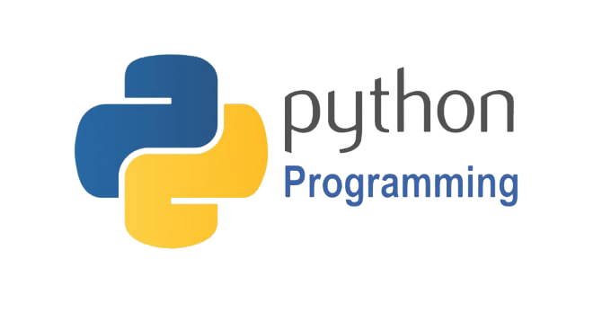

# python

Created: September 27, 2026 10:43 PM
Number: 18.0%
summary: New reason preventing your pages from being indexed
Search Console has identified that some pages on your site are not being indexed due to the following new reason:

**Basic Mathematics and Conditionals**

- **Swap two numbers without a third variable:** Teaches you how variables hold and transfer data using simple arithmetic (addition and subtraction) or bitwise XOR.
- **Check if a number is Even or Odd without using the modulo (`%`) operator:** Forces you to use bitwise AND (`&`) or integer division logic instead of relying on default operators.
- **Leap Year validation:** Builds strong understanding of combining `AND` (`&&`) and `OR` (`||`) logical operators (divisible by 4, but not 100, unless also divisible by 400).
- **Find the largest of three numbers:** Introduces nested `if-else` statements and decision trees.

**Loops and Number Manipulation**

- **Reverse an Integer (e.g., `456` to `654`):** Teaches the core logic of digit extraction using modulo (`% 10`) and division (`/ 10`) inside a `while` loop.
- **Calculate Factorial:** Introduces the concept of accumulating a running total/product across multiple iterations.
- **Generate the Fibonacci Sequence:** Requires tracking and updating multiple states (previous two numbers) to calculate the next number in the sequence.
- **Check for Prime Number:** Builds loop logic and introduces basic optimization (you only need to loop up to the square root of the number).
- **Armstrong Number Check (e.g., `153 = 1³ + 5³ + 3³`):** Combines digit extraction, power calculations, and sum accumulation into one problem.

**Nested Loops (Pattern Printing)**

- **Right-Angled Triangle ():** The standard introduction to nested loops, where the outer loop controls the row and the inner loop controls the columns.
- **Pyramid Pattern:** Adds a layer of complexity by requiring a third loop (or mathematical logic) to handle leading spaces before printing the characters.
- **Floyd’s Triangle (Numbers incrementing continuously across rows):** Teaches you how to maintain and update a global counter variable outside the scope of the inner loop.

**Basic Strings and Arrays**

- **Palindrome Check:** Teaches the fundamental "two-pointer" concept by comparing the first character with the last, moving inwards until they meet.
- **Linear Search:** The most basic array traversal technique, iterating through every element to find a specific target.
- **Count Vowels and Consonants:** Introduces string traversal, character evaluation, and maintaining multiple counters based on conditional checks.
